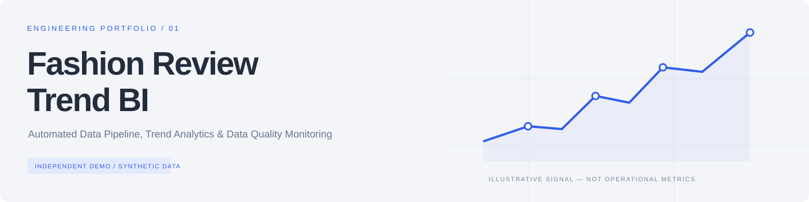
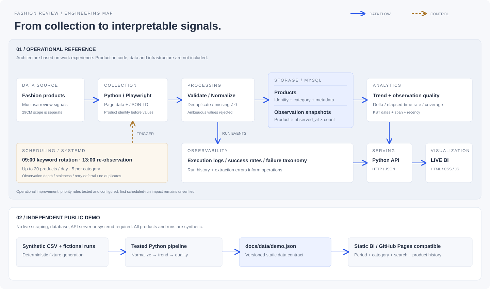
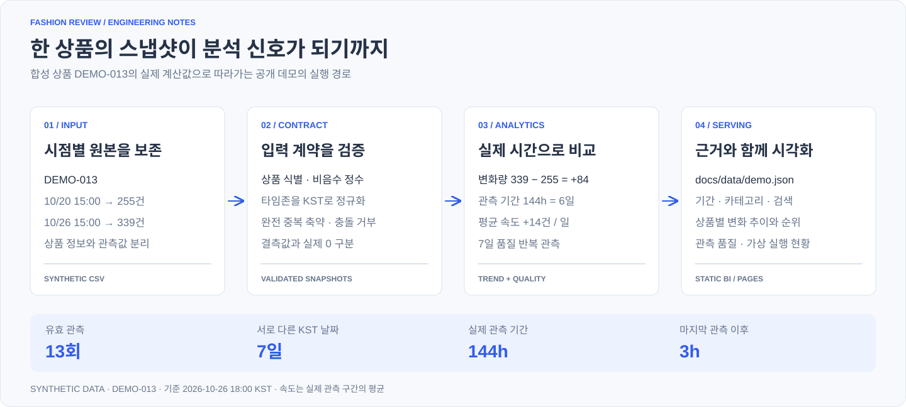
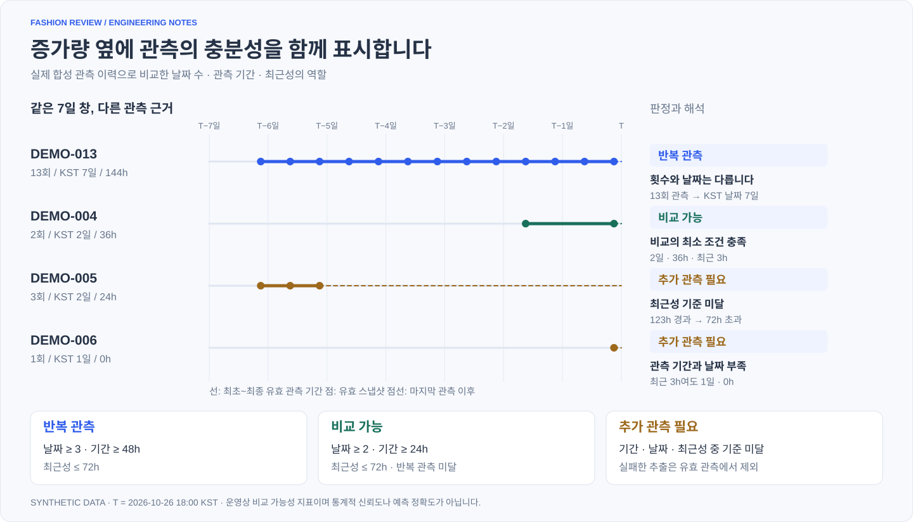
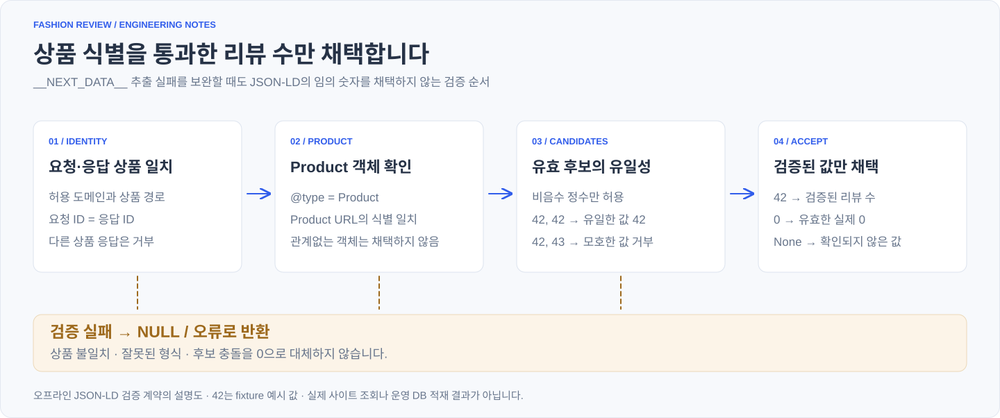
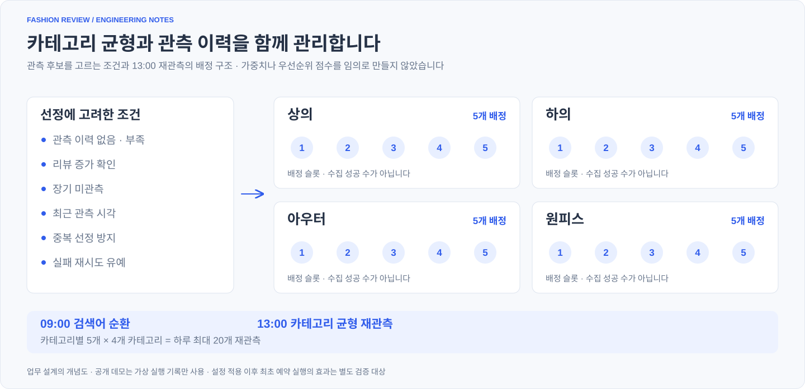
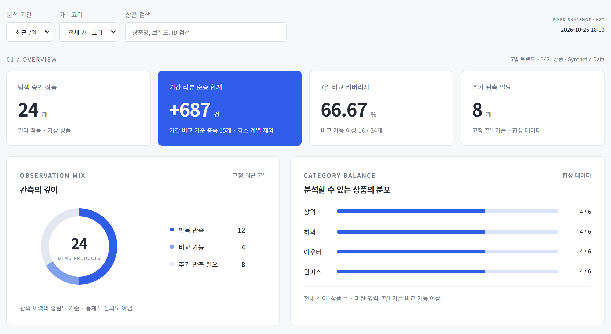
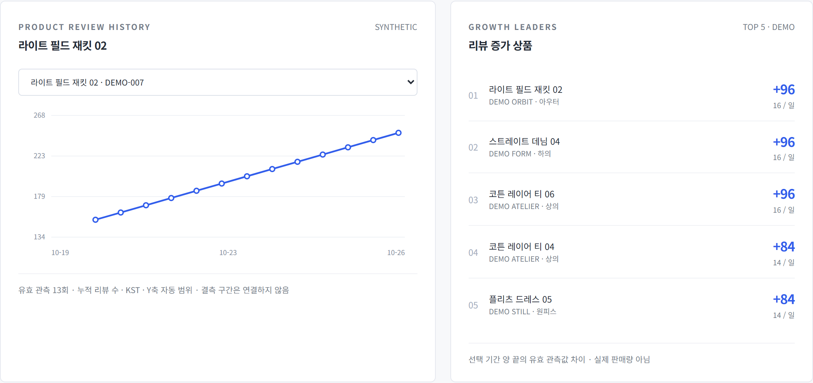

<p align="left"></p>

# Fashion Review Trend BI

**[View Live Demo](https://mepics2425-prog.github.io/fashion-review-trendbi/)** · **[Explore Source Code](https://github.com/mepics2425-prog/fashion-review-trendbi)**

**Automated Data Pipeline, Trend Analytics & Data Quality Monitoring**

패션 상품의 리뷰 변화를 분석하고, **그 변화를 비교할 만큼 관측이 충분한지** 함께 확인하는 데이터 파이프라인·BI 포트폴리오입니다.

**[데모 실행 안내](#demo--quick-start)** · **[대시보드 소스](docs/index.html)** · **[문제 해결 사례](docs/engineering-challenges.md)** · **[검증 기록](docs/validation.md)**

> 업무에서 경험한 설계·문제 해결을 설명하고, 공개 코드는 독립적으로 재구현했습니다. 모든 데모 데이터는 합성 데이터이며 회사 운영 코드·DB·내부 대시보드는 포함하지 않습니다. 공개 데모는 GitHub Pages에서 실행됩니다.



| Project Highlights | 설계의 핵심 |
| --- | --- |
| **숫자보다 상품 식별을 먼저** | JSON-LD 보조 추출 시 요청·응답 상품과 후보 유일성을 검증하고, 결측을 0으로 바꾸지 않음 |
| **스냅샷으로 변화를 보존** | 상품 정보와 시점별 관측을 분리하고, 실제 경과 시간에 기반해 변화량·속도를 계산 |
| **관측의 맥락까지 전달** | KST 날짜 수·관측 기간·최근성으로 비교 가능성을 평가하고 감소 이력을 별도로 표시 |
| **분석에 필요한 수집을 설계** | 업무에서 카테고리 균형·관측 부족·미관측·재시도 유예를 고려한 자동화 개선 |

**탐색:** [Overview](#project-overview) · [Problem](#problem-statement) · [Architecture](#architecture) · [Stack](#tech-stack) · [Features](#key-features) · [Pipeline](#data-pipeline) · [Quality](#data-quality-strategy) · [Challenges](#engineering-challenges) · [Preview](#dashboard-preview) · [Quick Start](#demo--quick-start) · [Testing](#validation--testing) · [Results](#results--limitations) · [Structure](#project-structure) · [Contributions](#my-contributions)

## Project Overview

무신사 상품의 리뷰 수와 평점을 수집·정규화하고 MySQL에 적재한 업무 경험에서 출발했습니다. 반복 관측으로 변화량을 만들고, 관측의 편중과 부족을 확인하며 분석·운영 상태까지 살펴보는 흐름을 설명합니다. 29CM 관련 수집·정규화 경험도 있으나 **리뷰 트렌드 BI의 주요 분석 대상은 무신사**이며 두 플랫폼의 처리 범위가 같다는 뜻은 아닙니다.

공개 데모에서는 가상 상품 24개와 관측 이력, 별도로 만든 가상 실행 14회를 사용합니다. 이 숫자는 **시연 데이터의 규모**이며 업무 성과가 아닙니다.

## Problem Statement

| 실제 문제 | 설계 판단 | 확인 가능한 근거 |
| --- | --- | --- |
| 페이지 구조에 따라 정확한 리뷰 수 추출 실패 | JSON-LD Product + 상품 식별 + 후보 유일성 검증 | 일부 실패 상품 재조회 확인이라는 업무 이력; 공개 코드는 오프라인 계약 테스트 |
| 일부 카테고리의 관측 편중 | 균등 할당·검색어 순환·관측 부족 상품 우선 | 테스트·운영 설정 적용 이력; 예약 실행 성과는 미검증 |
| 증가량만으로 해석 근거 부족 | 날짜·기간·최근성을 포함하는 품질 분류 | 공개 품질 규칙과 경계값 단위 테스트 |

## Architecture

운영 구조는 `Python / Playwright → 검증·정규화 → MySQL → Analytics → Python HTTP API → LIVE BI`입니다. systemd는 실행을 제어하고, 실행 로그는 성공률·실패 원인·최근 작업 현황을 제공합니다. 상품 메타데이터와 관측 스냅샷은 서로 다른 책임을 가집니다.

공개 구현은 `Synthetic CSV → Python 분석 → 정적 JSON → HTML/CSS/JS`입니다. MySQL·수집기·운영 API·systemd를 설치하지 않고 분석 원리를 재현합니다. [상세 구조와 논리 데이터 모델](docs/architecture.md)에서 실제 구현 범위를 확인할 수 있습니다.

## Tech Stack

| 영역 | 업무 경험의 기술 / 이유 | 공개 데모 구현 |
| --- | --- | --- |
| 수집 | Python / Playwright — 페이지 데이터 접근·검증 | 네트워크 수집 없음; JSON-LD 오프라인 검증 함수 |
| 처리·분석 | Python — 정규화·관측 비교·품질 평가 | Python 3.10+ / dataclass / csv / datetime |
| 저장 | MySQL — 상품과 시점별 관측 관리 | CSV 입력 / 버전 관리 가능한 JSON 산출물 |
| 자동화 | Ubuntu / systemd Service·Timer — 예약 실행·상태 확인 | 합성 실행 이력만 제공 |
| 서빙·화면 | Python HTTP API / HTML / CSS / JavaScript | 백엔드 없는 정적 사이트 / SVG 차트 |
| 검증 | 검증된 값만 적재, 실패 유형 관리 | unittest / 입력 계약·경계값·산출물 검증 |

공개 구현은 외부 패키지 없이 실행해 설치 비용을 줄였습니다. GitHub Pages에서도 상대 경로로 같은 JSON을 읽습니다.

## Key Features

- **Overview:** 상품 수, 기간 순증 합계, 고정 7일 비교 커버리지, 카테고리 분포.
- **Trend Analytics:** 3일·7일 필터, 증가 상품 순위, 상품별 관측 차트와 검색 가능한 표. 감소 계열은 순위 제외.
- **Data Quality:** 반복 관측·비교 가능·추가 관측 필요, 등급의 기준과 상품별 날짜·기간·최근성 노출.
- **Pipeline Monitoring:** 가상 실행의 날짜별 가중 성공률, 실패 유형, 시각별 실행 이력. 상품 필터와 독립임을 표시.

## Data Pipeline



합성 상품 `DEMO-013`의 실제 예시입니다. 리뷰 255→339, 관측 기간 144시간으로 **변화량 +84건 · 평균 +14건/일**을 계산하고 관측 근거를 함께 전달합니다.

<details>
<summary>단계별 구현과 실행 순서</summary>

1. 고정 시드 대신 명시적인 수식·기준 시각으로 합성 상품과 관측 fixture를 생성합니다.
2. 입력 문자열·상품 ID·카테고리·타임존·리뷰 수를 검증합니다.
3. 동일 상품·동일 순간의 완전 중복을 축약하고 충돌 레코드는 실패로 처리합니다.
4. 기간 안의 유효 관측으로 변화량과 실제 경과 시간당 평균 증가 속도를 계산합니다.
5. 고유 KST 날짜·기간·최근성으로 관측 품질을 평가합니다.
6. `docs/data/demo.json`으로 내보내고 브라우저에서 필터·차트·표를 표시합니다.

기준 시각은 **2026-10-26 18:00 KST**입니다. 같은 입력은 같은 결과를 만들며, 화면은 실시간으로 갱신되는 운영 환경이 아닙니다.

</details>

## Data Quality Strategy



같은 날 여러 번 수집해도 관측 날짜 수가 그만큼 늘지는 않습니다. **날짜·실제 관측 기간·최근성**을 함께 확인해야 오래된 데이터나 짧은 이력을 구분할 수 있습니다.

| 등급 | 최근 7일의 유효 관측 조건 |
| --- | --- |
| 반복 관측 | 서로 다른 KST 날짜 ≥ 3, 실제 기간 ≥ 48h, 최근 관측 이후 ≤ 72h |
| 비교 가능 | KST 날짜 ≥ 2, 실제 기간 ≥ 24h, 최근성 ≤ 72h, 반복 관측 미달 |
| 추가 관측 필요 | 위 기준 미달 |

**운영용 비교 가능성 지표이며 통계적으로 검증된 신뢰도가 아닙니다.** 추출 결측은 0과 구분하고 유효 관측 수에서 제외합니다. 음수 변화는 숨기지 않고 signed delta로 보존하되 성장 순위·속도에서 제외합니다. 데이터가 없는 경우 ‘—’를 표시합니다. [평가 창·분모·예외 정책](docs/data-quality.md)

## Engineering Challenges



| 사례 | 핵심 판단 | 검증과 한계 |
| --- | --- | --- |
| Reliable Review Count Extraction | `__NEXT_DATA__` 한계를 JSON-LD 보조 추출과 상품 식별 검증으로 보완 | 일부 상품 재조회 확인. 전체 성공률 향상 수치는 없음 |
| Category-balanced Observation Scheduling | 하루 최대 20개·4개 카테고리 균형과 관측 부족 우선 고려 | 테스트·설정 적용 완료 이력. 최초 예약 실행의 성과는 미확인 |
| Observation Quality Assessment | 분석값에 관측 근거를 결합 | 공개 테스트로 경계 검증. 통계적 정확도·예측력 주장 없음 |

각 사례의 **Problem → Root Cause → Solution → Validation → Trade-offs**는 [Engineering Challenges](docs/engineering-challenges.md)에 정리했습니다.

<details>
<summary>카테고리 균형 재관측 설계 보기</summary>



업무 설계를 설명하는 개념도입니다. 슬롯은 성공 건수가 아니며, 공개 데모가 실제 스케줄러를 실행한다는 의미도 아닙니다.

</details>

## Dashboard Preview

**Overview · 데이터 규모, 관측 품질과 카테고리 분포**



**Trend Analytics · 상품별 추이와 증가 순위**



[Overview 원본 PNG](docs/assets/dashboard-overview-2x.png) · [Trend 원본 PNG](docs/assets/dashboard-trends-2x.png) · [모바일 원본 PNG](docs/assets/dashboard-mobile-3x.png)

실제 공개 데모의 핵심 분석 영역을 **2배율 PNG**, 모바일 화면을 **3배율 PNG**로 캡처했습니다. 모든 표시값은 합성 데이터입니다. 위 링크에서 원본 해상도를 확인할 수 있습니다.

따뜻한 라이트 그레이·차콜·절제된 블루를 사용했습니다. 표와 차트가 같은 필터를 공유하며, 상품을 클릭하면 해당 관측 추이를 볼 수 있습니다. 키보드 조작용 label·focus·skip link, 텍스트 차트 설명, 작은 화면 레이아웃을 제공합니다. 표는 작은 화면에서 가로 스크롤합니다.

## Demo & Quick Start

Windows PowerShell 기준입니다. Python 3.10 이상 설치 후 `py --version`으로 확인합니다. `py`가 없으면 설치된 Python의 `python` 명령으로 바꾸세요.

```powershell
cd E:\fashion-review-trendbi
py -m src.generate_demo --regenerate-samples
py -m unittest discover -s tests -v
py -m http.server 8000 --directory docs
```

브라우저에서 **[http://localhost:8000](http://localhost:8000)**을 엽니다. `index.html`을 더블클릭하면 `file://` 환경에서 JSON fetch가 제한될 수 있으므로 HTTP 서버로 실행하세요. 종료는 PowerShell에서 `Ctrl+C`입니다. 외부 패키지가 없어 `pip install`은 필요하지 않습니다.

이미 포함된 CSV를 다시 분석하려면 `py -m src.generate_demo`만 실행합니다. `--regenerate-samples`는 CSV를 초기 합성 fixture로 다시 쓰므로 수정한 샘플을 보존하려면 빼세요. 포트 충돌 시 `8001` 등으로 바꾸고 브라우저 주소도 맞추세요.

### GitHub Pages 활성화

현재 [공개 데모](https://mepics2425-prog.github.io/fashion-review-trendbi/)는 **Deploy from a branch / `main` / `/docs`** 설정으로 배포되어 있습니다. `main`에 변경 사항을 Push하면 Pages가 다시 빌드합니다.

다른 저장소에서 재현할 경우 **Settings → Pages → Build and deployment → Source: Deploy from a branch → 게시할 branch → `/docs` → Save**를 선택합니다. 실제 배포가 완료되면 Pages 화면이 제공한 주소를 확인하세요.

저장소의 플랜·공개 범위에 따라 Pages 사용 가능 여부가 다릅니다. 공개 설정을 임의로 바꾸지 말고 계정 조건을 확인하세요. 절차는 [GitHub 공식 문서](https://docs.github.com/en/pages/getting-started-with-github-pages/configuring-a-publishing-source-for-your-github-pages-site)를 따릅니다.

## Validation & Testing

```powershell
py -m unittest discover -s tests -v
node --check docs/assets/site.js
py -m src.verify_project
```

Node는 JavaScript 문법 검사에만 필요하며 데모 실행에는 필요하지 않습니다. 단위 테스트는 KST 경계, 24·48·72h, 중복·충돌, null·0, 감소·중간 감소, 상품 식별 검증, 합성 fixture 재현성, JSON 계약을 확인합니다. 실제 실행 결과와 브라우저 확인 범위는 [검증 기록](docs/validation.md)에 명시합니다.

2026-10-27에는 Windows / Python 3.12.10에서 기존 34개를 재실행한 뒤 CSV 입력 경계와 실패 시 기존 산출물 보존 검사를 추가했습니다. 최신 검증은 **42개 테스트**를 대상으로 합니다. CSV 구조가 잘못되면 명확한 오류로 종료하고 이전 BI JSON은 덮어쓰지 않습니다.

설명용 SVG 4개는 `py -m src.generate_visuals`로 다시 생성할 수 있습니다. 상품 흐름과 관측 타임라인은 합성 JSON을 읽어 만들고, 추출 검증·관측 배정 그림은 문서에 명시한 설계 범위만 표현합니다.

## Results & Limitations

**확인 가능한 결과:** 합성 데이터 생성부터 분석·정적 JSON·BI 탐색까지 독립 실행 경로를 제공합니다. 업무 경험에서는 일부 추출 실패 상품의 값을 재조회해 확인했고, 개선한 우선순위 방식을 테스트·설정 적용했습니다. 이는 사용자 제공 이력이며 회사 운영 자료로 재검증한 주장은 아닙니다.

**검증하지 않은 것:** 전체 수집 성공률 개선 폭, 새 우선순위 최초 예약 실행 효과, 현재 상품 페이지 호환성, 실서비스 부하·DB 성능·운영 가용성. 데모의 가상 성공률은 이 성과를 대신하지 않습니다.

리뷰 수는 판매량·매출·수요의 직접 측정치가 아닙니다. 관측 기간이 상품마다 다르며 증가 속도는 해당 구간의 평균입니다. 관측 선택 편향, 리뷰 삭제·지연, 상품 노출 차이를 통제하지 않습니다.

## Project Structure

```text
fashion-review-trendbi/
├── README.md
├── requirements.txt             # 외부 의존성 없음
├── docs/
│   ├── index.html               # GitHub Pages용 정적 BI
│   ├── architecture.md          # 운영 참조 / 공개 구현 경계
│   ├── engineering-challenges.md
│   ├── data-quality.md
│   ├── validation.md
│   ├── assets/                  # 구조도·커버·미리보기·CSS·JS
│   └── data/demo.json           # 계산된 합성 BI 데이터
├── src/
│   ├── models.py
│   ├── data_loader.py
│   ├── data_validator.py
│   ├── trend_analyzer.py
│   ├── quality_rules.py
│   ├── review_extractor.py      # 네트워크 없는 추출 계약 데모
│   ├── synthetic_data.py
│   ├── generate_demo.py
│   ├── generate_visuals.py      # 설명용 SVG 4종 재생성
│   └── verify_project.py
├── sample_data/                 # 가상 상품·관측 CSV
└── tests/                       # 단위·계약 테스트
```

## My Contributions

| 구분 | 설명 |
| --- | --- |
| 업무 경험에서 담당한 영역 | Python·Playwright 수집, 정규화·MySQL 적재, 리뷰 재관측, JSON-LD 보조 추출과 식별 검증, systemd 자동화, 품질 지표·LIVE BI 구성 |
| 공개 포트폴리오 구현 | 위 경험의 설계 원리를 설명하기 위해 별도로 작성한 합성 데이터·Python 분석·오프라인 검증·정적 BI·테스트·문서 |
| 채용 직무별 검토 지점 | Data Engineering: 입력 계약·스냅샷·자동화 설계 / Analytics: 변화량·분모·관측 창 / Data QA: 경계·실패 정책 / AX: 반복 작업 자동화와 운영 가시성 |

공개 데모가 회사에서 사용한 운영 구현물이라는 의미는 아닙니다. 회사 자산을 복제하지 않고 기술적 판단과 확인 가능한 구현을 함께 제시합니다.
