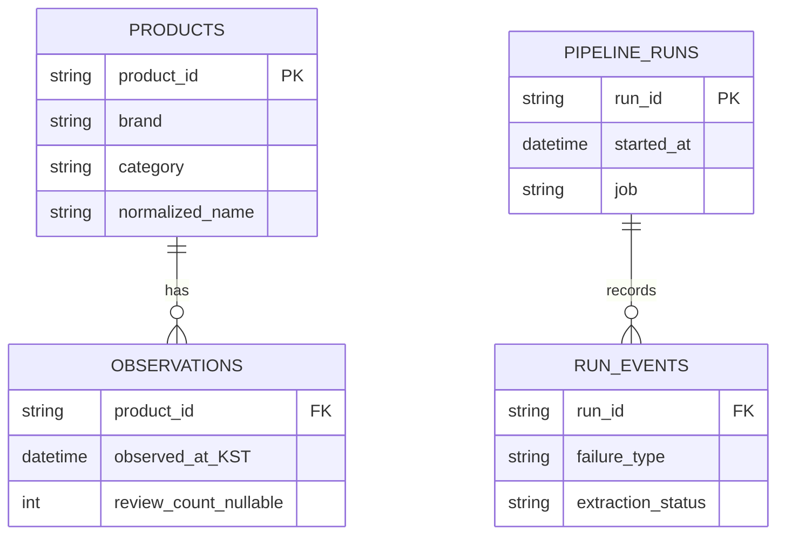

# Architecture

**업무에서 경험한 운영 구조**와 **개인용 공개 구현**은 별개다. 이 저장소는 운영 서버에 접속하지 않으며 회사 코드·DB·내부 화면을 포함하지 않는다.


## 운영 경험의 참조 구조

| 영역 | 책임 | 설계 이유 |
| --- | --- | --- |
| Data Source | 무신사 상품·리뷰 수·평점 | 상품별 반복 관측을 통한 변화 파악. 29CM 수집·정규화 경험과 분석 범위를 구분 |
| Collection | Python / Playwright, 페이지 데이터 및 JSON-LD 보조 추출 | 페이지 구조 차이에도 식별 검증을 통과한 값만 채택 |
| Processing | 브랜드·카테고리 정규화, 중복·결측 처리 | 수집 성공과 데이터 정확성을 별도로 관리 |
| Storage | MySQL 상품 테이블 / 관측 스냅샷 | 상품의 식별·메타데이터와 시점별 누적 리뷰 수를 분리 |
| Scheduling | Ubuntu systemd Service / Timer | 프로세스 실행과 예약 관리를 분리하고 실행 이력을 확인 |
| Analytics | 리뷰 변화량, 실제 경과 시간당 증가 속도, 커버리지·품질 | 비교값과 관측 근거를 함께 제공 |
| Serving / Visualization | Python HTTP API → HTML / CSS / JavaScript LIVE BI | 분석 결과와 화면 표시 책임 분리 |
| Observability | 실행 이력·날짜별 성공률·실패 원인 | 실패를 정상값으로 숨기지 않고 운영 의사결정에 활용 |

파란 실선은 데이터, 황색 점선은 실행 제어다. 스케줄러가 데이터베이스를 대신하거나 데이터를 직접 전달하는 것처럼 표현하지 않았다. 시각화는 분석 응답과 운영 이벤트를 각각 조회하는 구조를 요약했다.

### 데이터 모델의 역할

아래는 설명용 논리 모델이며 운영 DDL의 복사본이 아니다.



관측의 논리 키는 `(product_id, observed_at)`이다. 날짜 단위로 덮어쓰지 않아 실제 경과 시간과 같은 날 재관측을 보존한다. DB 구현 시 시각의 타임존 정책, 유일 키, 트랜잭션 및 인덱스를 명시해야 한다. 공개 데모는 DB 구현·성능을 검증하지 않는다.

### 자동화의 운영 맥락

- **09:00 KST:** 카테고리별 검색어 순환으로 리뷰·평점 갱신.
- **13:00 KST:** 상의·하의·아우터·원피스에 각 5개, 하루 최대 20개 상품 재관측.
- 관측 이력 없음·부족, 리뷰 증가, 장기 미관측, 최근 관측 시각, 중복 방지, 실패 재시도 유예를 선정 조건에 활용.
- 새로운 우선순위 방식은 테스트·운영 설정 적용까지 완료했다는 사용자 제공 이력을 설명한다. 최초 예약 실행의 실제 성과는 별도 검증 대상이다.

정확한 가중치나 tie-break 순서는 제공되지 않았으므로 임의로 운영 알고리즘을 발명하지 않았다. 이 저장소는 실시간 수집·스케줄러를 구현한 것으로 주장하지 않는다.

## 공개 데모의 실제 실행 경로

```text
synthetic_data.py → sample_data/*.csv → data_loader / data_validator
                                      ↓
                         trend_analyzer / quality_rules
                                      ↓
                             docs/data/demo.json
                                      ↓ fetch (relative URL)
                         docs/index.html + assets/site.js
```

Python 3.10+ 표준 라이브러리만 사용한다. 외부 API, 인증키, Playwright, MySQL 설치가 필요하지 않다. JSON은 Python에서 계산한 3일·7일 분석 창을 포함하며 브라우저는 필터·집계·표시만 담당한다. 관측 품질 등급은 UI에서 최근 7일 기준을 고정하고 트렌드 순위 자격은 선택 기간의 비교 기준도 확인한다.

`as_of`는 `2026-10-26T18:00:00+09:00`로 고정한다. 현재 시각을 넣지 않아 재현 결과가 날짜에 따라 바뀌지 않는다. 시연 데이터의 마지막 시각을 오늘의 수집 결과로 오해해서는 안 된다.

## 데모 경계

| 실행되는 것 | 설명만 제공하는 것 |
| --- | --- |
| 합성 CSV 생성, 정규화, 중복·결측 검증 | 실제 사이트 수집, Playwright 브라우저 제어 |
| 스냅샷 분석, 품질 분류, JSON 내보내기 | MySQL 적재·운영용 SQL 성능 |
| 오프라인 JSON-LD 식별·유일성 검증 테스트 | 현재 상품 페이지 호환성, 전체 추출 성공률 |
| 정적 BI 필터·차트·표·가상 모니터링 | systemd 실행·타이머 설정 및 운영 API |

[README](../README.md) · [품질 규칙](data-quality.md) · [Engineering Challenges](engineering-challenges.md)
